<div align="center">

<picture>
  <source media="(prefers-color-scheme: dark)" srcset="docs/assets/wardarr-lockup-on-dark.svg" />
  
</picture>

### Ein ruhiger Ort für deinen ganzen Medien-Stack.

Wardarr hält Wache über deine \*arr-Apps, Download-Clients, Medienserver, Seerr und Tdarr,
damit du es nicht musst. Es fasst Probleme nach ihrer Ursache zusammen, räumt die
Download-Warteschlange mit Bedacht auf, sucht fehlende Titel in ruhigem Tempo und lässt alle
zu Hause etwas zum Anschauen anfragen.

<a href="https://mki002.github.io/wardarr-app/"><b>Live-Demo ausprobieren</b></a> ·
<a href="#installation">Installation</a> ·
<a href="#ein-rundgang">Rundgang</a> ·
<a href="#einstellungen">Einstellungen</a> ·
<a href="#anleitungen">Anleitungen</a> ·
<a href="README.md">English</a>

[](https://github.com/MKI002/wardarr-app/actions/workflows/ci.yml)
[](https://github.com/MKI002/wardarr-app/releases)
[](https://github.com/MKI002/wardarr-app/pkgs/container/wardarr-app)
[](https://mki002.github.io/wardarr-app/)
[](LICENSE)

<br />

<picture>
  <source media="(prefers-color-scheme: light)" srcset="docs/assets/hero-light.png" />
  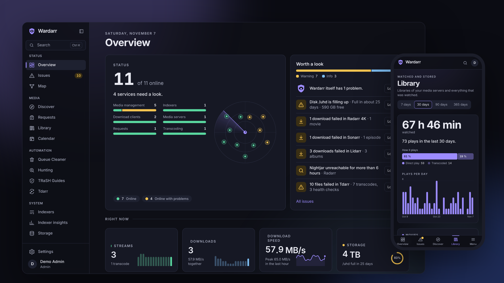
</picture>

<sub>Alle Screenshots zeigen die erfundene Demo-Umgebung. Titel, Benutzer und Zahlen sind ausgedacht; die Filme sind gemeinfrei. Die Oberfläche gibt es auch auf Deutsch.</sub>

</div>

## Warum Wardarr

Ein Medien-Stack besteht aus einem Dutzend Apps, die jede ein bisschen wissen. Fällt ein
Indexer aus, beschweren sich drei von ihnen an drei verschiedenen Stellen. Wardarr liest sie
alle, findet heraus, was wirklich passiert ist, und sagt es dir in einem Satz, die Lösung einen
Klick entfernt. Alles andere folgt derselben Idee: **auf einen Blick zeigen, was zählt, den
Rest auf Nachfrage erklären und nie hinter deinem Rücken handeln.**

- **Ruhig von Haus aus.** Was sich innerhalb einer Minute selbst erledigt, bleibt still. Der
  Queue Cleaner startet im Probelauf, Hunting hat ein Budget, und jeder TRaSH-Sync zeigt
  vorher eine Vorschau.
- **Für dein Setup gemacht.** Zwei Sonarr, ein 4K-Radarr, drei Medienserver: Jedes Produkt
  lässt sich beliebig oft verbinden. Wardarr erkennt Version und API jedes Dienstes und zieht
  nach einem Update mit.
- **Deins.** Ein Container, eine SQLite-Datei, kein Cloud-Konto, keine Telemetrie, kein
  Nach-Hause-Telefonieren.

## Ein Rundgang

Die Seitenleiste ordnet Wardarrs Seiten nach der Frage, mit der du es öffnest.

### Status: Ist alles in Ordnung?

<table>
  <tr>
    <td width="50%">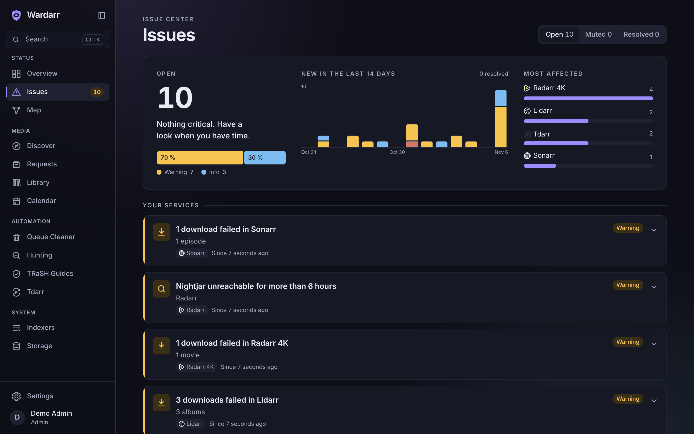</td>
    <td width="50%">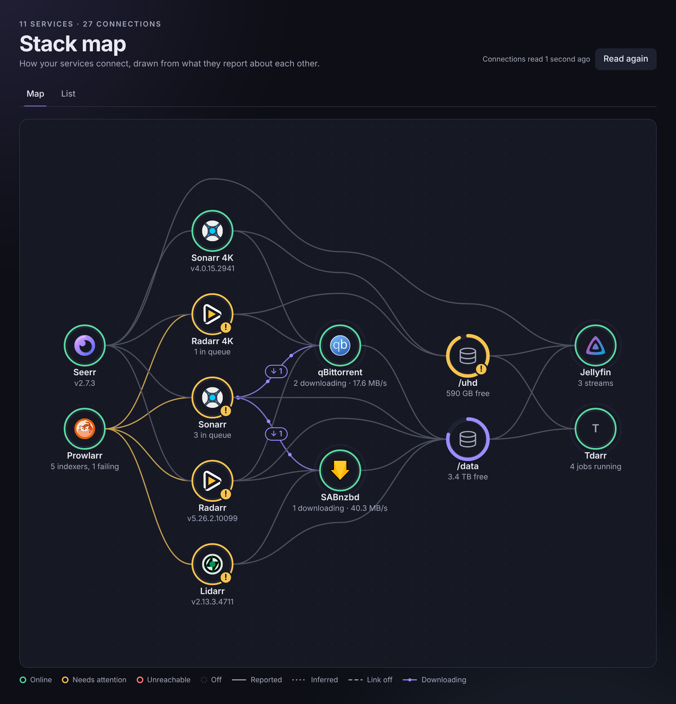</td>
  </tr>
  <tr>
    <td valign="top"><b>Probleme nach Ursache, nicht nach Meldung.</b> Ein ausgefallener Indexer wird zu
    einem Problem mit den betroffenen Instanzen, der Lösung und einem Link zur passenden
    Einstellungsseite. Bekanntes lässt sich stummschalten, gelöste Probleme bleiben im
    Verlauf.</td>
    <td valign="top"><b>Eine Karte deines Stacks</b>, gezeichnet aus dem, was die Dienste übereinander
    melden: welche App an welchen Download-Client schickt, welche Platte sie teilen und wo es
    hakt.</td>
  </tr>
</table>

Die **Übersicht** zeigt alles auf einem Bildschirm: jeden Dienst als Punkt auf dem Radar, was
einen Blick wert ist und was gerade läuft, lädt und sich füllt.

### Medien: Was gibt es zu sehen?

<table>
  <tr>
    <td width="50%">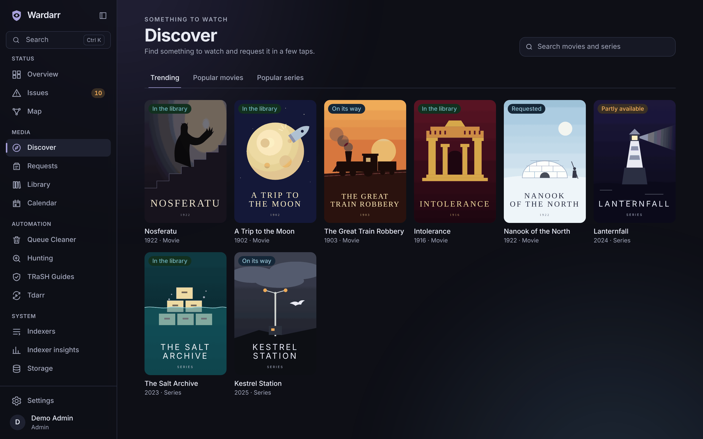</td>
    <td width="50%">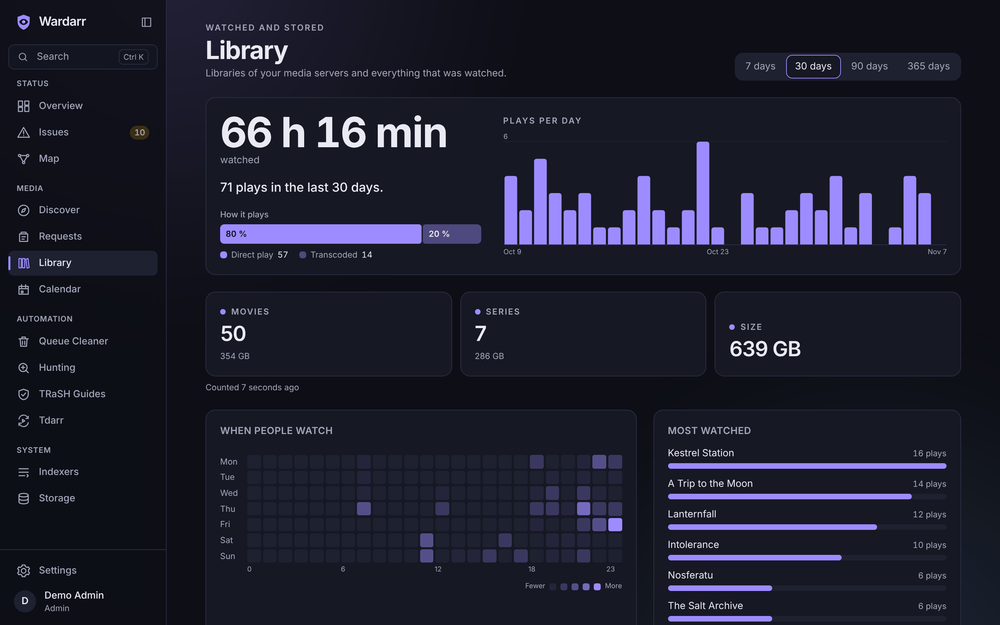</td>
  </tr>
  <tr>
    <td valign="top"><b>Entdecken und anfragen.</b> Trends, Beliebtes und Suche. Anfragen laufen über Seerr
    als der richtige Seerr-Benutzer, damit Rechte, Kontingente und Freigaben dort bleiben.
    Standard oder 4K, und Admins geben auf derselben Seite frei.</td>
    <td valign="top"><b>Bibliothek und Streams.</b> Größe und Anzahl je Medienserver, was gerade läuft,
    Wiedergaben pro Tag, wann geschaut wird und die meistgesehenen Titel.</td>
  </tr>
  <tr>
    <td>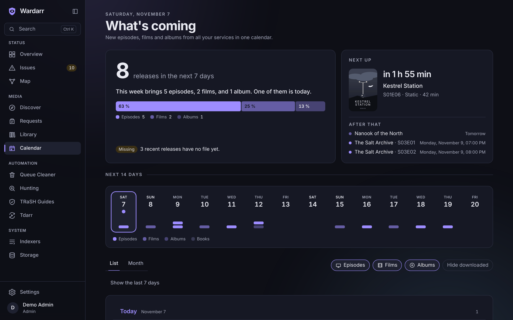</td>
    <td>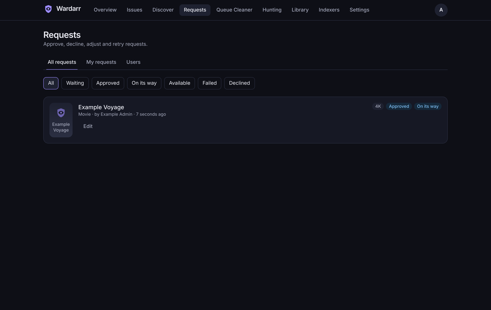</td>
  </tr>
  <tr>
    <td valign="top"><b>Was kommt.</b> Ein Kalender für alle Sonarr, Radarr, Lidarr und Readarr; derselbe
    Termin aus zwei Instanzen erscheint einmal. Dazu ein privater iCal-Link für deine
    Kalender-App.</td>
    <td valign="top"><b>Anfragen</b> freigeben, ablehnen, anpassen oder neu senden, mit jedem Schritt von
    „wartet“ bis „verfügbar“.</td>
  </tr>
</table>

### Automatik: Was erledigt Wardarr für mich?

<table>
  <tr>
    <td width="50%">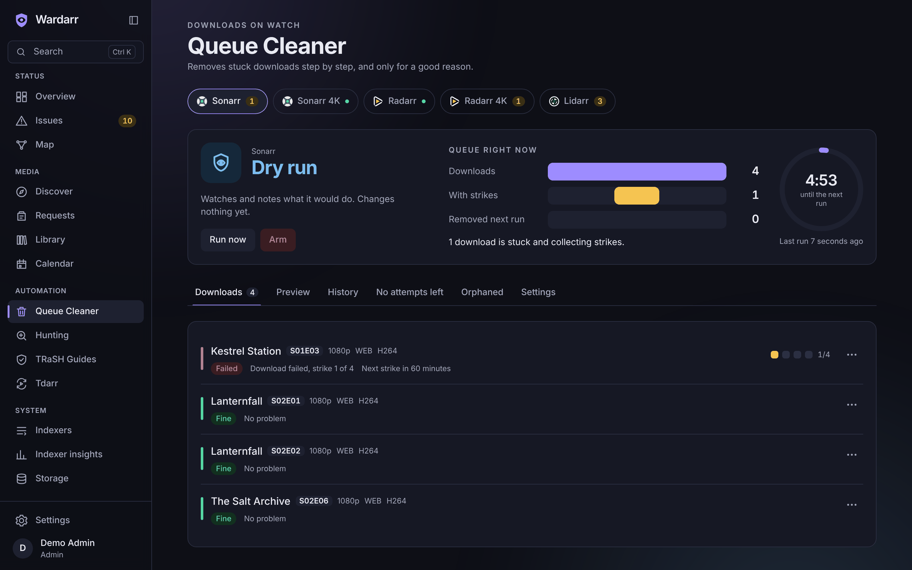</td>
    <td width="50%">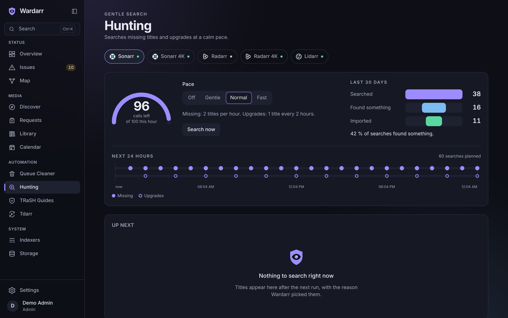</td>
  </tr>
  <tr>
    <td valign="top"><b>Ein Queue Cleaner, der erst fragt.</b> Er startet im Probelauf und zeigt, was er tun
    würde. Hängende, fehlgeschlagene und stockende Downloads sammeln Strikes, bevor etwas
    entfernt wird, saubere Importe warten auf dein „Import prüfen“, und Scharfschalten ist ein
    bewusster Schritt.</td>
    <td valign="top"><b>Hunting in ruhigem Tempo.</b> Fehlende Titel und Upgrades werden in kleinen
    Portionen gesucht, mit einem Budget für API-Aufrufe, einer Pause, wenn Indexer ausfallen,
    und einer Liste, was als Nächstes kommt und warum.</td>
  </tr>
  <tr>
    <td>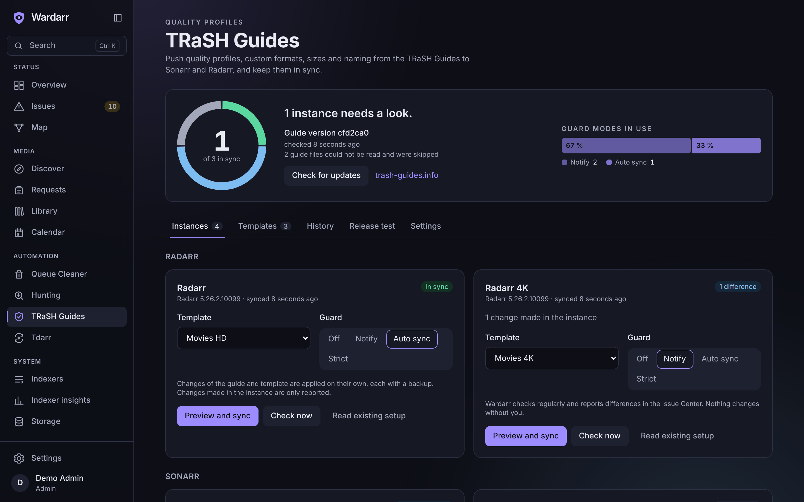</td>
    <td>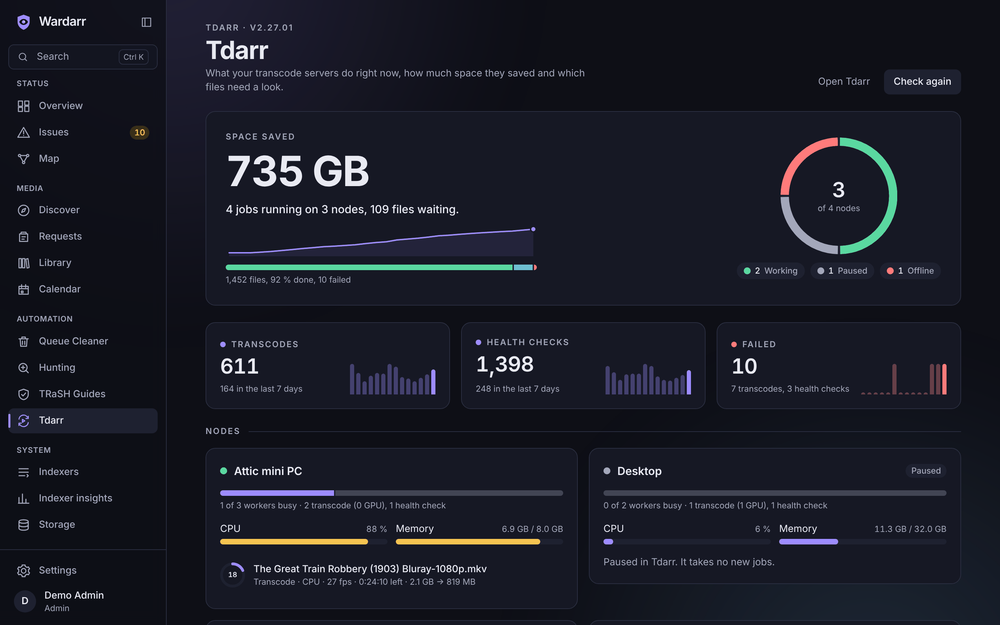</td>
  </tr>
  <tr>
    <td valign="top"><b>TRaSH Guides, immer synchron.</b> Qualitätsprofile, Custom Formats, Größen und
    Benennung für beliebig viele Sonarr und Radarr. Jeder Sync zeigt vorher jede Änderung Feld
    für Feld und legt ein Backup zum Zurückrollen an; ein Wächter meldet Abweichungen oder
    behebt sie und hält bei großen Änderungen an.</td>
    <td valign="top"><b>Tdarr auf einen Blick.</b> Gesparter Platz, Nodes und ihre Worker, die
    Warteschlange und die fehlgeschlagenen Dateien. Ein Node, der offline geht, oder ein Job,
    der sich nicht mehr bewegt, wird zum Problem.</td>
  </tr>
</table>

### System: Wie steht es um den Unterbau?

<table>
  <tr>
    <td width="50%">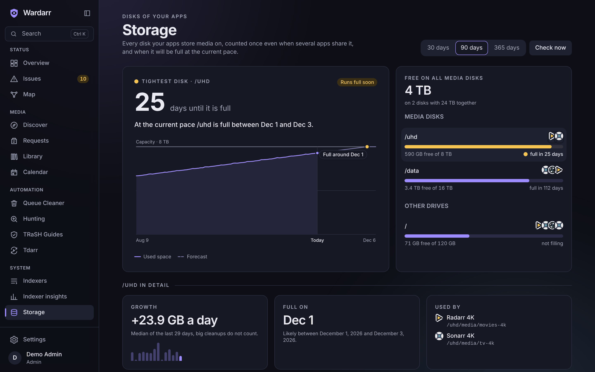</td>
    <td width="50%">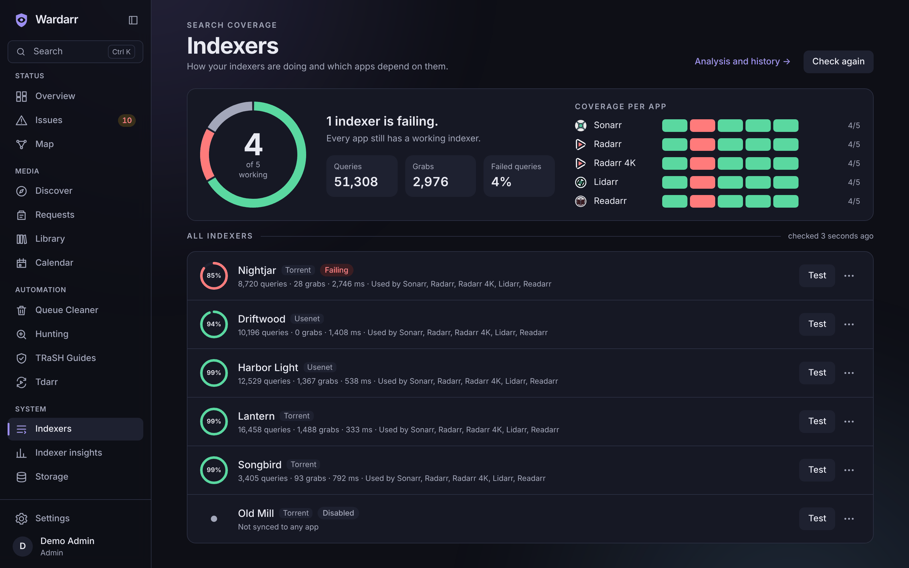</td>
  </tr>
  <tr>
    <td valign="top"><b>Speicher mit Prognose.</b> Jede Platte deiner Apps, einmal gezählt, auch wenn mehrere
    Apps sie teilen, mit dem Tag, an dem sie im jetzigen Tempo voll ist. Läuft eine Platte bald
    voll, wird sie zum Problem, bevor Downloads stehen bleiben.</td>
    <td valign="top"><b>Indexer-Statistiken.</b> Abfragen, Grabs, Fehler und Antwortzeiten je Indexer aus
    Prowlarr, und welche Apps ohne funktionierenden Indexer dastehen.</td>
  </tr>
</table>

In den **Einstellungen** liegen die Dienste, Benutzer, **Benachrichtigungen** (E-Mail, ntfy,
Discord, Gotify, Telegram oder jeder Webhook; standardmäßig neue Probleme, alles andere auf
Wunsch) und **Backups** mit Smart Retention: ein Regler für wie oft und wie lange, ein Backup
vor jedem Datenbank-Update, Wiederherstellen mit einem Klick und ein passwortgeschützter
Download für den Umzug auf einen neuen Server.

### Überall

<table>
  <tr>
    <td width="64%">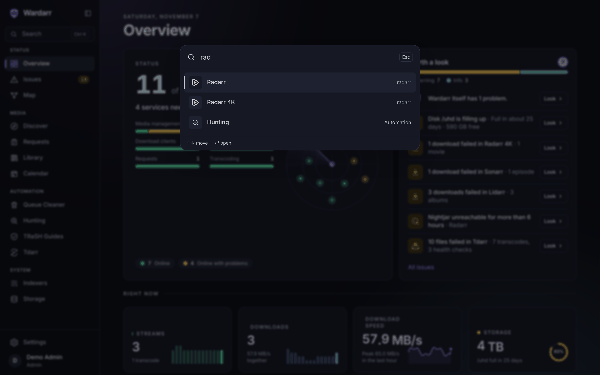</td>
    <td width="18%">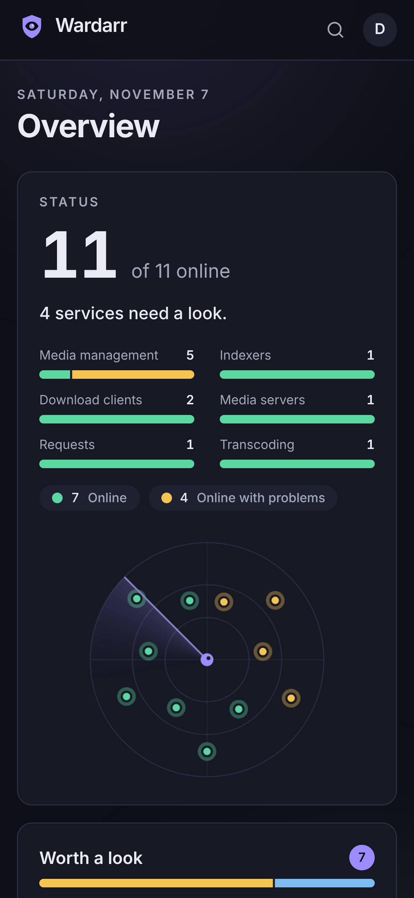</td>
    <td width="18%">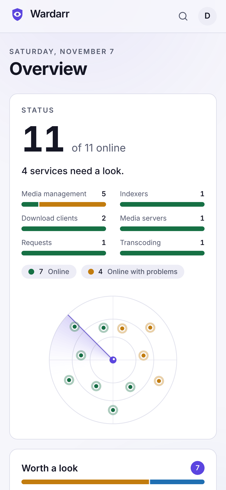</td>
  </tr>
</table>

Mit <kbd>Strg</kbd> <kbd>K</kbd> (oder <kbd>⌘</kbd> <kbd>K</kbd> oder <kbd>/</kbd>) springst du
zu jeder Seite, Einstellung und jedem Dienst. Dunkles und helles Design folgen deinem System,
die App lässt sich aufs Handy installieren und vollständig mit der Tastatur bedienen, auf
Deutsch und Englisch.

## Unterstützte Dienste

| Art              | Dienste                                                                                                                                                                                                                                                                                                                                                                                                                                                                                                              |
| ---------------- | -------------------------------------------------------------------------------------------------------------------------------------------------------------------------------------------------------------------------------------------------------------------------------------------------------------------------------------------------------------------------------------------------------------------------------------------------------------------------------------------------------------------- |
| Medienverwaltung |  Sonarr ·  Radarr ·  Lidarr ·  Whisparr ·  Readarr (upstream eingestellt) ·  Bazarr |
| Indexer          |  Prowlarr                                                                                                                                                                                                                                                                                                                                                                                                                                     |
| Download-Clients |  SABnzbd ·  NZBGet ·  qBittorrent ·  Transmission ·  Deluge                                                                                     |
| Medienserver     |  Jellyfin ·  Plex ·  Emby                                                                                                                                                                                                                                                                               |
| Anfragen         |  Seerr                                                                                                                                                                                                                                                                                                                                                                                                                                           |
| Transkodierung   | Tdarr                                                                                                                                                                                                                                                                                                                                                                                                                                                                                                                |

Fehlt einer? Adapter sind klein und in sich geschlossen, siehe den
[Adapter-Leitfaden](docs/guide/adapters.md) (englisch).

## Installation

Wardarr läuft als ein Container. Images für `linux/amd64` und `linux/arm64` liegen in der
GitHub Container Registry.

### Docker Compose

```yaml
services:
  wardarr:
    image: ghcr.io/mki002/wardarr-app:latest
    container_name: wardarr
    restart: unless-stopped
    ports:
      - '8484:8484'
    volumes:
      - ./wardarr:/data
    environment:
      TZ: Europe/Berlin
```

```sh
docker compose up -d
```

Ein kommentiertes Beispiel mit allen Optionen liegt in [deploy/docker-compose.yml](deploy/docker-compose.yml).

### docker run

```sh
docker run -d --name wardarr --restart unless-stopped \
  -p 8484:8484 -v "$PWD/wardarr:/data" \
  ghcr.io/mki002/wardarr-app:latest
```

### Unraid

Die Vorlage [deploy/unraid/wardarr.xml](deploy/unraid/wardarr.xml) unter
**Docker → Template repositories** hinzufügen oder nach
`/boot/config/plugins/dockerMan/templates-user/` kopieren. Der Appdata-Ordner wird zu `/data`; die Vorlage startet Wardarr als `99:100`, dem üblichen Unraid-Besitzer von Appdata.

### Erster Start

`http://<dein-server>:8484` öffnen. Der Einrichtungsassistent legt den ersten Admin an und
führt durch das Hinzufügen der Dienste. Nur Admins fügen Dienste hinzu; alle anderen können
entdecken, anfragen und die Bibliothek ansehen.

Der Datenordner muss für Benutzer `1000:1000` beschreibbar sein. Er enthält die
SQLite-Datenbank und den erzeugten Schlüssel, gehört also ins Backup.

## Einstellungen

Alles Weitere wird in der Weboberfläche eingestellt. Diese Umgebungsvariablen sind optional:

| Variable                  | Standard  | Wirkung                                                                                                                                                      |
| ------------------------- | --------- | ------------------------------------------------------------------------------------------------------------------------------------------------------------ |
| `WARDARR_PORT`            | `8484`    | Port, auf dem Wardarr lauscht.                                                                                                                               |
| `WARDARR_HOST`            | `0.0.0.0` | Adresse, auf der Wardarr lauscht.                                                                                                                            |
| `WARDARR_DATA_DIR`        | `/data`   | Datenbank und erzeugter Schlüssel.                                                                                                                           |
| `WARDARR_BACKUP_DIR`      | `backups` | Ordner für die eigenen Backups von Wardarr; ohne Angabe `backups` im Datenordner. Lege ihn wenn möglich auf ein anderes Laufwerk.                            |
| `WARDARR_SECRET_KEY`      | erzeugt   | 32-Byte-Schlüssel (Base64 oder Hex), der gespeicherte Zugangsdaten verschlüsselt. Ohne Angabe wird er beim ersten Start erzeugt und im Datenordner abgelegt. |
| `WARDARR_PUBLIC_URL`      | keine     | Adresse, unter der du Wardarr öffnest, für Links in Benachrichtigungen.                                                                                      |
| `WARDARR_TRUST_PROXY`     | `false`   | `X-Forwarded-*`-Headern vertrauen. Hinter einem Reverse Proxy einschalten.                                                                                   |
| `WARDARR_COOKIE_SECURE`   | `auto`    | Secure-Flag am Sitzungs-Cookie; `auto` setzt es bei HTTPS.                                                                                                   |
| `WARDARR_HTTP_TIMEOUT_MS` | `10000`   | Zeitlimit für Aufrufe an deine Dienste.                                                                                                                      |
| `WARDARR_LOG_LEVEL`       | `info`    | `fatal`, `error`, `warn`, `info`, `debug`, `trace` oder `silent`.                                                                                            |
| `WARDARR_TRASH_DIR`       | keiner    | Lokale Kopie der TRaSH Guides, die statt des Downloads von GitHub verwendet wird.                                                                            |

### Hinter einem Reverse Proxy

Wardarr auf einer eigenen (Sub-)Domain ausliefern, `WARDARR_TRUST_PROXY=true` setzen und für
Links in Benachrichtigungen `WARDARR_PUBLIC_URL`. WebSockets braucht Wardarr nicht; Live-Updates
laufen über Server-Sent Events, also für `/api/events` das Puffern im Proxy abschalten.

## Sicherheit und Datenschutz

- Jede Seite und jeder API-Aufruf braucht eine Anmeldung, außer Anmeldung, Einrichtung und
  `/healthz`.
- Passwörter werden mit Argon2id gehasht. API-Schlüssel und Tokens werden mit AES-256-GCM
  verschlüsselt, nie an den Browser zurückgegeben und in Logs maskiert.
- Nur Admins fügen Dienste hinzu. Wardarr lehnt Adressen ab, die auf Cloud-Metadaten oder
  Link-Local-Bereiche zeigen, und gibt Zugangsdaten bei Weiterleitungen nie weiter. Dein LAN
  ist erlaubt.
- Der Container läuft als unprivilegierter Benutzer.
- Keine Telemetrie, keine Analyse, kein Nach-Hause-Telefonieren. Poster laden über Wardarr,
  der Poster-Server sieht also nicht, wer zuschaut.

Eine Schwachstelle gefunden? Bitte [SECURITY.md](SECURITY.md) lesen.

## Anleitungen

Die Anleitungen sind auf Englisch:

- [Queue Cleaner](docs/guide/queue-cleaner.md)
- [Hunting](docs/guide/hunting.md)
- [Entdecken und Anfragen](docs/guide/discover-and-requests.md)
- [TRaSH Guides](docs/guide/trash-guides.md)
- [Speicher](docs/guide/storage.md)
- [Bibliothek und Indexer](docs/guide/library.md)
- [Stack-Map](docs/guide/stack-map.md) (englisch)
- [Backups](docs/guide/backups.md)
- [Kalender](docs/guide/calendar.md)
- [Tdarr](docs/guide/tdarr.md)
- [Download-Clients prüfen](docs/guide/download-clients.md)
- [Benachrichtigungen](docs/guide/notifications.md)
- [Einen Adapter schreiben](docs/guide/adapters.md)
- [Live-Demo](docs/demo.md): wie die Demo entsteht und warum ihre Filme gemeinfrei sind
- [Entscheidungen](docs/decisions/)

## Entwicklung

Siehe [README.md](README.md#development), [CONTRIBUTING.md](CONTRIBUTING.md) und den
[Design-Leitfaden](docs/DESIGN.md) (englisch).

## Lizenz

[MIT](LICENSE). Copyright The Wardarr Authors.

Wardarr gehört zu keinem der Projekte, mit denen es sich verbindet, und wird von ihnen nicht
unterstützt. Ihre Logos gehören diesen Projekten und stehen unter deren eigenen Lizenzen, siehe
[NOTICE.md](NOTICE.md).
