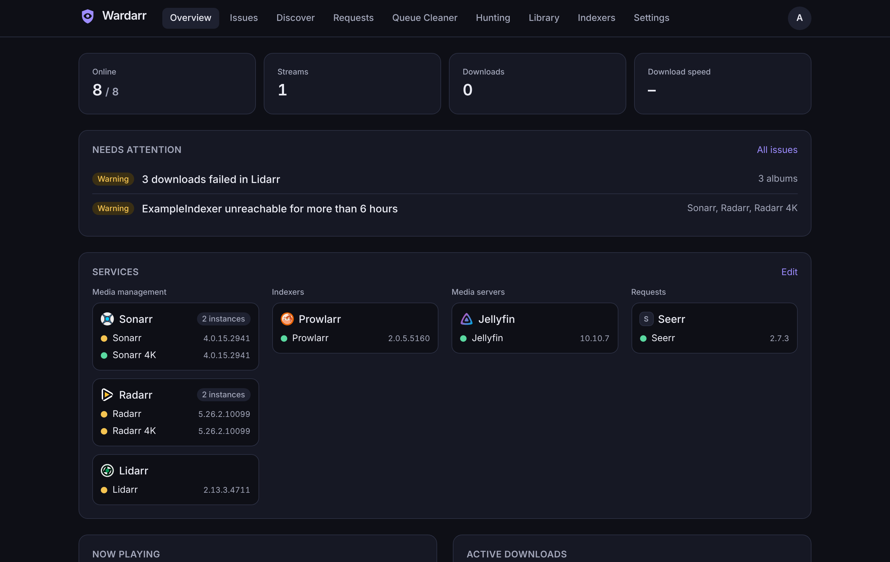
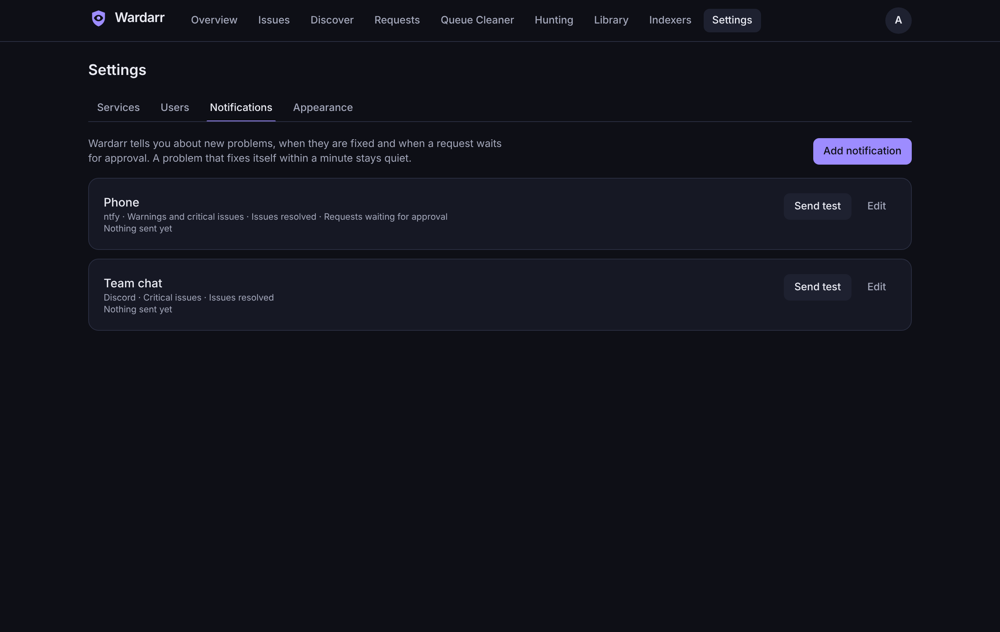
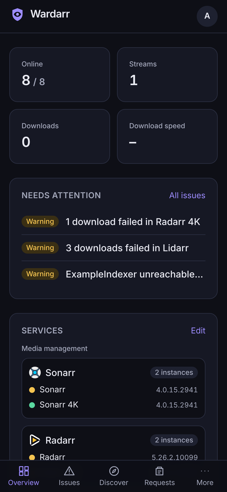

<div align="center">

<picture>
  <source media="(prefers-color-scheme: dark)" srcset="docs/assets/wardarr-lockup-on-dark.svg" />
  
</picture>

**Ein ruhiger Ort für deinen ganzen Medien-Stack.**

Eine selbst gehostete Zentrale für die \*arr-Apps, Download-Clients, Medienserver und Seerr.
Wardarr fasst Probleme nach ihrer Ursache zusammen, räumt die Download-Warteschlange mit Bedacht
auf, sucht fehlende Titel in ruhigem Tempo und lässt alle im Haushalt etwas zum Anschauen
anfragen.

[**Live-Demo**](https://mki002.github.io/wardarr-app/) · [Installation](#installation) · [Funktionen](#funktionen) · [Einstellungen](#einstellungen) · [Anleitungen](#anleitungen) · [English](README.md)

[](https://github.com/MKI002/wardarr-app/actions/workflows/ci.yml)
[](https://github.com/MKI002/wardarr-app/releases)
[](https://github.com/MKI002/wardarr-app/pkgs/container/wardarr-app)
[](https://mki002.github.io/wardarr-app/)
[](LICENSE)



<sub>Alle Screenshots zeigen die erfundene Testumgebung. Titel, Benutzer und Zahlen sind ausgedacht.</sub>

</div>

## Funktionen

- **Probleme nach Ursache, nicht nach Meldung.** Fällt ein Indexer aus, beschweren sich
  Sonarr, Radarr und Radarr 4K. Wardarr zeigt das als ein Problem mit den betroffenen
  Instanzen, der Lösung und einem Link zur passenden Einstellungsseite. Bekanntes lässt sich
  stummschalten, gelöste Probleme bleiben im Verlauf.
- **Ein Queue Cleaner, der erst fragt.** Er startet im Probelauf und zeigt, was er tun würde.
  Hängende, fehlgeschlagene und stockende Downloads sammeln Strikes, bevor etwas entfernt wird,
  saubere Importe warten auf dein „Import prüfen“, und Scharfschalten ist ein bewusster Schritt.
- **Hunting in ruhigem Tempo.** Fehlende Titel und Upgrades werden in kleinen Portionen
  gesucht, mit einem Budget für API-Aufrufe, einer Pause, wenn Indexer ausfallen, und einer
  Liste, was als Nächstes kommt und warum.
- **Entdecken und anfragen.** Trends, Beliebtes und Suche. Anfragen laufen über Seerr als der
  richtige Seerr-Benutzer, damit Rechte, Kontingente und Freigaben dort bleiben. Standard oder
  4K, und Admins geben auf derselben Seite frei.
- **TRaSH Guides, immer synchron.** Vorlagen mit Qualitätsprofilen, Custom Formats, Größen und
  Benennung aus den TRaSH Guides für beliebig viele Sonarrs und Radarrs. Jeder Sync zeigt vorher
  jede Änderung Feld für Feld und legt ein Backup an, das sich zurückrollen lässt; ein Wächter
  meldet Abweichungen oder hält Instanzen selbst synchron und hält bei großen Änderungen an.
- **Backups mit Smart Retention.** Ein Regler entscheidet, wie oft Wardarr sich selbst sichert
  und wie der Verlauf mit dem Alter ausdünnt. Ein Backup vor jedem Datenbank-Update,
  Wiederherstellen mit einem Klick und ein passwortgeschützter Download, der alles auf einen
  neuen Server mitnimmt.
- **Bibliothek und Streams.** Größe und Anzahl je Medienserver, was gerade läuft, Wiedergaben
  pro Tag, meistgesehene Titel und wer was geschaut hat.
- **Was kommt.** Ein Kalender für alle Sonarr, Radarr, Lidarr und Readarr; derselbe Termin aus
  zwei Instanzen erscheint einmal. Dazu ein privater iCal-Link für Kalender-Apps.
- **Indexer-Statistiken.** Abfragen, Grabs, Fehler und Antwortzeiten je Indexer aus Prowlarr,
  und welche Apps an einem ausfallenden Indexer hängen.
- **Benachrichtigungen** per E-Mail, ntfy, Discord, Gotify, Telegram oder an jeden Webhook.
  Standardmäßig neue Probleme ab einer Schwelle; gelöste Probleme und Anfragen, die auf Freigabe
  warten, auf Wunsch. Was sich innerhalb einer Minute selbst erledigt, bleibt still.
- **Kennt deine Versionen.** Wardarr erkennt Version und API jedes Dienstes und spricht nach
  einem Update weiter richtig mit ihm. Geht ein Produkt über das Getestete hinaus, sagt Wardarr
  das und wechselt in einen vorsichtigen Kompatibilitätsmodus.
- **Mehrere Instanzen je Produkt.** Zwei Sonarr, ein 4K-Radarr, zwei Medienserver: alles kein
  Problem.
- **Fürs Sofa und fürs Handy.** Dunkles und helles Design nach Systemeinstellung, als App
  installierbar, auf dem Handy und mit der Tastatur voll bedienbar, auf Deutsch und Englisch.

## Screenshots

|                                                           |                                                                  |
| --------------------------------------------------------- | ---------------------------------------------------------------- |
|                   |                    |
| **Probleme** mit einem Eintrag je Ursache                 | **Queue Cleaner** im Probelauf, mit Strikes und nächstem Schritt |
|                |                       |
| **Entdecken**, was schon da, unterwegs oder angefragt ist | **Bibliothek** mit Statistiken und Wiedergaben                   |
|                 |         |
| **Anfragen** freigeben, ablehnen oder neu senden          | **Benachrichtigungen** je Kanal und Schwelle                     |

<p align="center">
  
  <br />
  <sub>Die <b>Stack-Map</b> zeichnet deinen Stack aus dem, was die Dienste voneinander melden.</sub>
</p>

<p align="center">
  
</p>

## Unterstützte Dienste

| Art              | Dienste                                                                  |
| ---------------- | ------------------------------------------------------------------------ |
| Medienverwaltung | Sonarr, Radarr, Lidarr, Whisparr, Readarr (upstream eingestellt), Bazarr |
| Indexer          | Prowlarr                                                                 |
| Download-Clients | SABnzbd, NZBGet, qBittorrent, Transmission, Deluge                       |
| Medienserver     | Jellyfin, Plex, Emby                                                     |
| Anfragen         | Seerr                                                                    |

Fehlt einer? Adapter sind klein und in sich geschlossen, siehe den
[Adapter-Leitfaden](docs/guide/adapters.md) (englisch).

## Installation

Wardarr läuft als ein Container. Images für `linux/amd64` und `linux/arm64` liegen in der
GitHub Container Registry.

### Docker Compose

```yaml
services:
  wardarr:
    image: ghcr.io/mki002/wardarr-app:latest
    container_name: wardarr
    restart: unless-stopped
    ports:
      - '8484:8484'
    volumes:
      - ./wardarr:/data
    environment:
      TZ: Europe/Berlin
```

```sh
docker compose up -d
```

Ein kommentiertes Beispiel mit allen Optionen liegt in [deploy/docker-compose.yml](deploy/docker-compose.yml).

### docker run

```sh
docker run -d --name wardarr --restart unless-stopped \
  -p 8484:8484 -v "$PWD/wardarr:/data" \
  ghcr.io/mki002/wardarr-app:latest
```

### Unraid

Die Vorlage [deploy/unraid/wardarr.xml](deploy/unraid/wardarr.xml) unter
**Docker → Template repositories** hinzufügen oder nach
`/boot/config/plugins/dockerMan/templates-user/` kopieren. Der Appdata-Ordner wird zu `/data`; die Vorlage startet Wardarr als `99:100`, dem üblichen Unraid-Besitzer von Appdata.

### Erster Start

`http://<dein-server>:8484` öffnen. Der Einrichtungsassistent legt den ersten Admin an und
führt durch das Hinzufügen der Dienste. Nur Admins fügen Dienste hinzu; alle anderen können
entdecken, anfragen und die Bibliothek ansehen.

Der Datenordner muss für Benutzer `1000:1000` beschreibbar sein. Er enthält die
SQLite-Datenbank und den erzeugten Schlüssel, gehört also ins Backup.

## Einstellungen

Alles Weitere wird in der Weboberfläche eingestellt. Diese Umgebungsvariablen sind optional:

| Variable                  | Standard  | Wirkung                                                                                                                                                      |
| ------------------------- | --------- | ------------------------------------------------------------------------------------------------------------------------------------------------------------ |
| `WARDARR_PORT`            | `8484`    | Port, auf dem Wardarr lauscht.                                                                                                                               |
| `WARDARR_HOST`            | `0.0.0.0` | Adresse, auf der Wardarr lauscht.                                                                                                                            |
| `WARDARR_DATA_DIR`        | `/data`   | Datenbank und erzeugter Schlüssel.                                                                                                                           |
| `WARDARR_BACKUP_DIR`      | `backups` | Ordner für die eigenen Backups von Wardarr; ohne Angabe `backups` im Datenordner. Lege ihn wenn möglich auf ein anderes Laufwerk.                            |
| `WARDARR_SECRET_KEY`      | erzeugt   | 32-Byte-Schlüssel (Base64 oder Hex), der gespeicherte Zugangsdaten verschlüsselt. Ohne Angabe wird er beim ersten Start erzeugt und im Datenordner abgelegt. |
| `WARDARR_PUBLIC_URL`      | keine     | Adresse, unter der du Wardarr öffnest, für Links in Benachrichtigungen.                                                                                      |
| `WARDARR_TRUST_PROXY`     | `false`   | `X-Forwarded-*`-Headern vertrauen. Hinter einem Reverse Proxy einschalten.                                                                                   |
| `WARDARR_COOKIE_SECURE`   | `auto`    | Secure-Flag am Sitzungs-Cookie; `auto` setzt es bei HTTPS.                                                                                                   |
| `WARDARR_HTTP_TIMEOUT_MS` | `10000`   | Zeitlimit für Aufrufe an deine Dienste.                                                                                                                      |
| `WARDARR_LOG_LEVEL`       | `info`    | `fatal`, `error`, `warn`, `info`, `debug`, `trace` oder `silent`.                                                                                            |
| `WARDARR_TRASH_DIR`       | keiner    | Lokale Kopie der TRaSH Guides, die statt des Downloads von GitHub verwendet wird.                                                                            |

### Hinter einem Reverse Proxy

Wardarr auf einer eigenen (Sub-)Domain ausliefern, `WARDARR_TRUST_PROXY=true` setzen und für
Links in Benachrichtigungen `WARDARR_PUBLIC_URL`. WebSockets braucht Wardarr nicht; Live-Updates
laufen über Server-Sent Events, also für `/api/events` das Puffern im Proxy abschalten.

## Sicherheit und Datenschutz

- Jede Seite und jeder API-Aufruf braucht eine Anmeldung, außer Anmeldung, Einrichtung und
  `/healthz`.
- Passwörter werden mit Argon2id gehasht. API-Schlüssel und Tokens werden mit AES-256-GCM
  verschlüsselt, nie an den Browser zurückgegeben und in Logs maskiert.
- Nur Admins fügen Dienste hinzu. Wardarr lehnt Adressen ab, die auf Cloud-Metadaten oder
  Link-Local-Bereiche zeigen, und gibt Zugangsdaten bei Weiterleitungen nie weiter. Dein LAN
  ist erlaubt.
- Der Container läuft als unprivilegierter Benutzer.
- Keine Telemetrie, keine Analyse, kein Nach-Hause-Telefonieren. Poster laden über Wardarr,
  der Poster-Server sieht also nicht, wer zuschaut.

Eine Schwachstelle gefunden? Bitte [SECURITY.md](SECURITY.md) lesen.

## Anleitungen

Die Anleitungen sind auf Englisch:

- [Queue Cleaner](docs/guide/queue-cleaner.md)
- [Hunting](docs/guide/hunting.md)
- [Entdecken und Anfragen](docs/guide/discover-and-requests.md)
- [TRaSH Guides](docs/guide/trash-guides.md)
- [Bibliothek und Indexer](docs/guide/library.md)
- [Stack-Map](docs/guide/stack-map.md) (englisch)
- [Backups](docs/guide/backups.md)
- [Kalender](docs/guide/calendar.md)
- [Benachrichtigungen](docs/guide/notifications.md)
- [Einen Adapter schreiben](docs/guide/adapters.md)
- [Live-Demo](docs/demo.md): wie die Demo entsteht und warum ihre Filme gemeinfrei sind
- [Entscheidungen](docs/decisions/)

## Entwicklung

Siehe [README.md](README.md#development) und [CONTRIBUTING.md](CONTRIBUTING.md).

## Lizenz

[MIT](LICENSE). Copyright The Wardarr Authors.

Wardarr gehört zu keinem der Projekte, mit denen es sich verbindet, und wird von ihnen nicht
unterstützt. Ihre Logos gehören diesen Projekten und stehen unter deren eigenen Lizenzen, siehe
[NOTICE.md](NOTICE.md).
