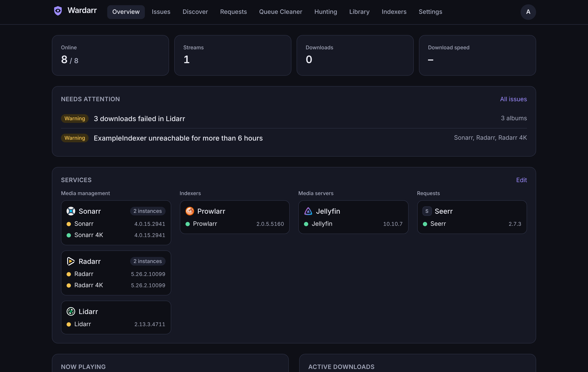
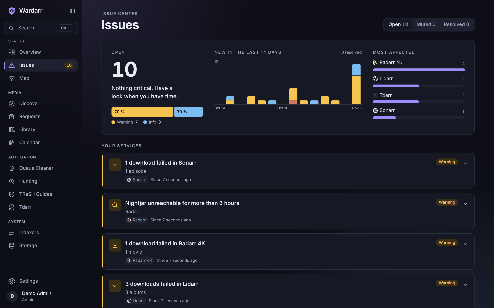
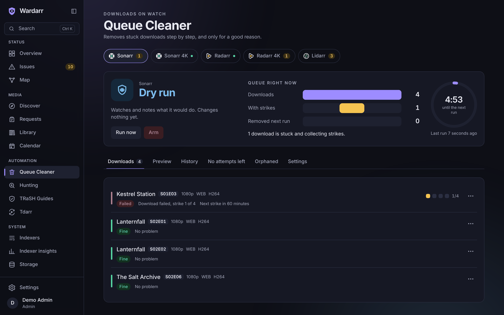
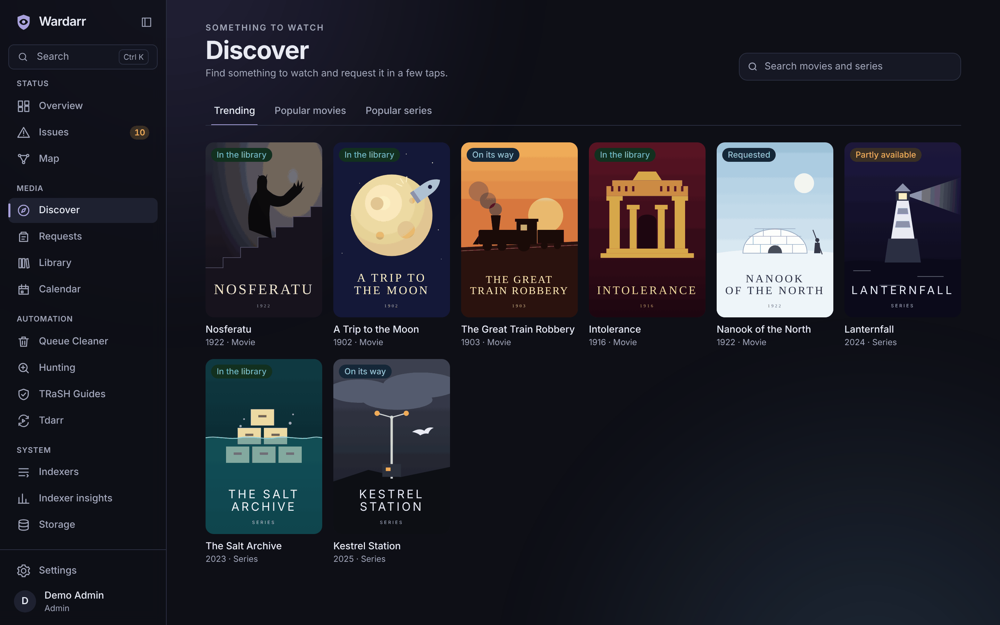
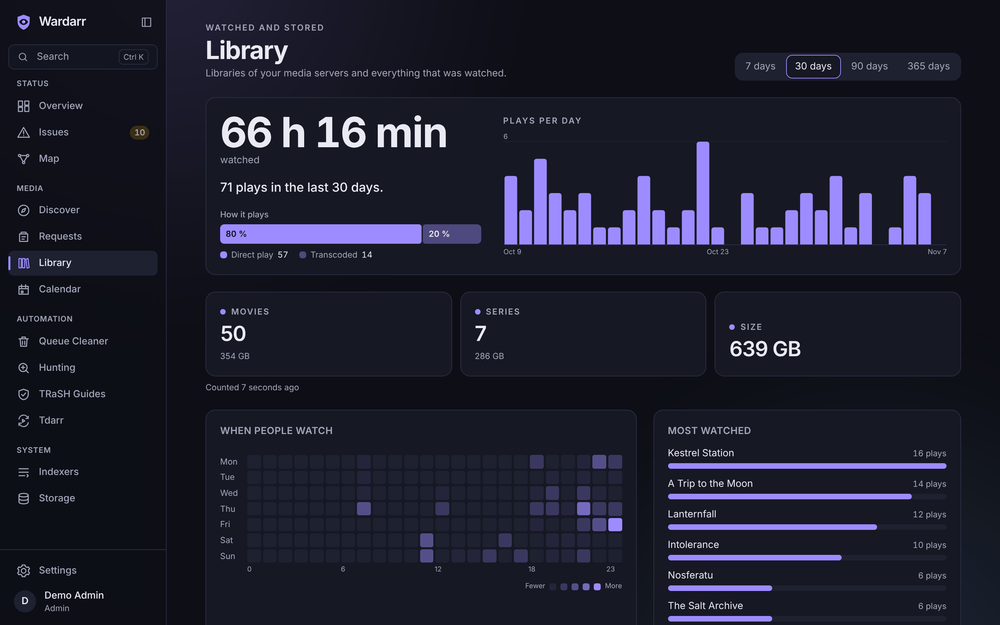
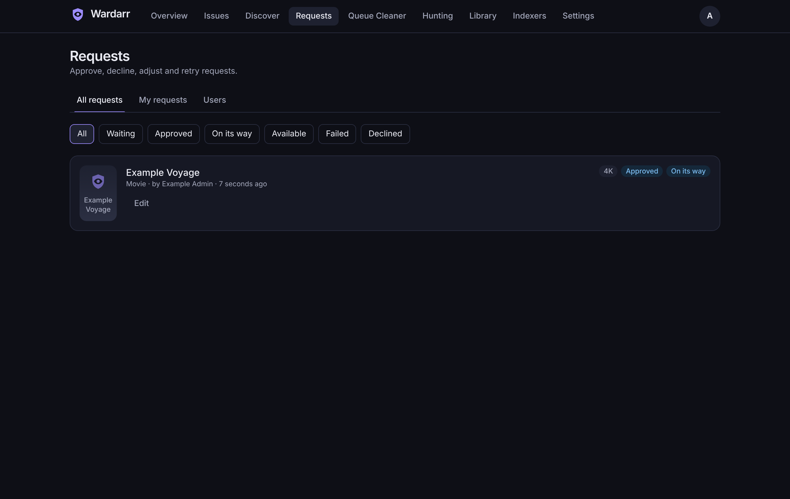
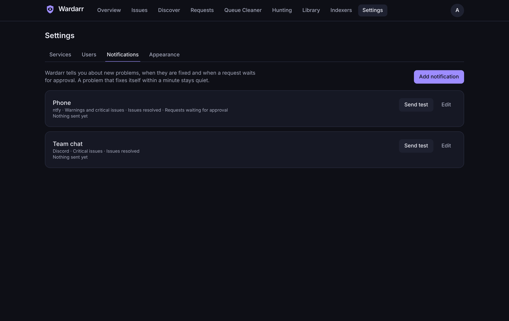
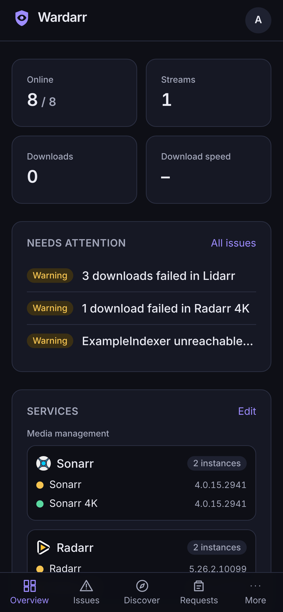

<div align="center">

<picture>
  <source media="(prefers-color-scheme: dark)" srcset="docs/assets/wardarr-lockup-on-dark.svg" />
  
</picture>

**One calm place for your whole media stack.**

A self-hosted control center for the \*arr apps, download clients, media servers and Seerr.
Wardarr groups problems by their cause, cleans the download queue carefully, hunts for missing
titles at a gentle pace and lets everyone in the house request something to watch.

[Install](#install) · [Features](#features) · [Configuration](#configuration) · [Guides](#guides) · [Deutsch](README.de.md)

[](https://github.com/MKI002/wardarr-app/actions/workflows/ci.yml)
[](https://github.com/MKI002/wardarr-app/releases)
[](https://github.com/MKI002/wardarr-app/pkgs/container/wardarr-app)
[](LICENSE)



<sub>All screenshots show the invented test setup. Every title, user and number is made up.</sub>

</div>

## Features

- **Issues by cause, not by message.** When one indexer fails, Sonarr, Radarr and Radarr 4K
  all complain. Wardarr shows that as one issue with the instances it affects, the fix and a
  link to the right settings page. Mute what you know about; resolved issues stay in the
  history.
- **A queue cleaner that asks first.** It starts in dry run and shows what it would do. Stuck,
  failed and stalled downloads collect strikes before anything is removed, clean imports wait
  for your "Review import", and arming it is a deliberate step.
- **Hunting at a calm pace.** Missing titles and upgrades are searched a few at a time, with a
  budget for API calls, a pause when indexers are down and a list of what comes next and why.
- **Discover and request.** Trending and popular titles, search, and requests that go through
  Seerr as the right Seerr user, so its permissions, quotas and approvals stay in charge.
  Standard or 4K, and the admin approves from the same page.
- **Library and streams.** Library sizes and counts per media server, what is playing right
  now, plays per day, most watched titles and who watched what.
- **Indexer statistics.** Queries, grabs, failures and response times per indexer from
  Prowlarr, and which apps depend on an indexer that is failing.
- **Notifications** by e-mail, ntfy, Discord, Gotify, Telegram or any webhook. New issues
  above a threshold by default; resolved issues and requests waiting for approval when you want
  them. Problems that fix themselves within a minute stay quiet.
- **Knows your versions.** Wardarr detects the version and API of each service and keeps
  talking to it correctly after an update. When a product moves beyond what was tested, it
  says so and switches to a careful compatibility mode.
- **Several instances per product.** Two Sonarrs, a 4K Radarr, two media servers: all fine.
- **Made for the couch and the phone.** Dark and light themes that follow your system,
  installable as an app, fully usable on a phone and with the keyboard, in English and German.

## Screenshots

|                                                              |                                                              |
| ------------------------------------------------------------ | ------------------------------------------------------------ |
|                  |                |
| **Issue Center** with one entry per cause                    | **Queue Cleaner** in dry run, with strikes and the next step |
|                    |                      |
| **Discover** what is in the library, on its way or requested | **Library** statistics and plays over time                   |
|                    |          |
| **Requests** to approve, decline or retry                    | **Notifications** per channel and threshold                  |

<p align="center">
  
</p>

## Supported services

| Kind             | Services                                                                         |
| ---------------- | -------------------------------------------------------------------------------- |
| Media management | Sonarr, Radarr, Lidarr, Whisparr, Readarr (no longer developed upstream), Bazarr |
| Indexers         | Prowlarr                                                                         |
| Download clients | SABnzbd, NZBGet, qBittorrent, Transmission, Deluge                               |
| Media servers    | Jellyfin, Plex, Emby                                                             |
| Requests         | Seerr                                                                            |

Missing one? Adapters are small and self-contained, see the [adapter guide](docs/guide/adapters.md).

## Install

Wardarr runs as one container. Images for `linux/amd64` and `linux/arm64` are published to the
GitHub Container Registry.

### Docker Compose

```yaml
services:
  wardarr:
    image: ghcr.io/mki002/wardarr-app:latest
    container_name: wardarr
    restart: unless-stopped
    ports:
      - '8484:8484'
    volumes:
      - ./wardarr:/data
    environment:
      TZ: Etc/UTC
```

```sh
docker compose up -d
```

A commented example with every option is in [deploy/docker-compose.yml](deploy/docker-compose.yml).

### docker run

```sh
docker run -d --name wardarr --restart unless-stopped \
  -p 8484:8484 -v "$PWD/wardarr:/data" \
  ghcr.io/mki002/wardarr-app:latest
```

### Unraid

Add the template from [deploy/unraid/wardarr.xml](deploy/unraid/wardarr.xml) under
**Docker → Template repositories**, or copy it to `/boot/config/plugins/dockerMan/templates-user/`.
The appdata folder becomes `/data`; the template runs Wardarr as `99:100`, the usual Unraid owner of appdata.

### First start

Open `http://<your-server>:8484`. The setup wizard creates the first admin and walks you through
adding your services. Only admins can add services; everyone else can discover, request and
look at the library.

The data folder must be writable by user `1000:1000`. It holds the SQLite database and the
generated encryption key, so include it in your backups.

## Configuration

Everything else is set in the web interface. These environment variables are optional:

| Variable                  | Default   | What it does                                                                                                                     |
| ------------------------- | --------- | -------------------------------------------------------------------------------------------------------------------------------- |
| `WARDARR_PORT`            | `8484`    | Port to listen on.                                                                                                               |
| `WARDARR_HOST`            | `0.0.0.0` | Address to listen on.                                                                                                            |
| `WARDARR_DATA_DIR`        | `/data`   | Database and generated key.                                                                                                      |
| `WARDARR_SECRET_KEY`      | generated | 32-byte key (base64 or hex) that encrypts stored credentials. Generated on first start and kept in the data folder when not set. |
| `WARDARR_PUBLIC_URL`      | none      | Address you open Wardarr at, for links in notifications.                                                                         |
| `WARDARR_TRUST_PROXY`     | `false`   | Trust `X-Forwarded-*` headers. Turn on behind a reverse proxy.                                                                   |
| `WARDARR_COOKIE_SECURE`   | `auto`    | Secure flag on the session cookie; `auto` sets it for HTTPS requests.                                                            |
| `WARDARR_HTTP_TIMEOUT_MS` | `10000`   | Timeout for calls to your services.                                                                                              |
| `WARDARR_LOG_LEVEL`       | `info`    | `fatal`, `error`, `warn`, `info`, `debug`, `trace` or `silent`.                                                                  |

### Behind a reverse proxy

Serve Wardarr on its own (sub)domain, set `WARDARR_TRUST_PROXY=true` and, for notification
links, `WARDARR_PUBLIC_URL`. Wardarr does not need WebSockets; live updates use
server-sent events, so turn off response buffering for `/api/events` if your proxy buffers.

## Security and privacy

- Every page and API call needs a login, except the login, the setup wizard and `/healthz`.
- Passwords are hashed with Argon2id. API keys and tokens are encrypted with AES-256-GCM,
  never sent back to the browser and masked in logs.
- Only admins can add services. Wardarr refuses addresses that point at cloud metadata or
  link-local ranges and never forwards credentials on redirects. Your LAN is fine.
- The container runs as an unprivileged user.
- No telemetry, no analytics, no calls home. Posters are loaded through Wardarr, so the poster
  host never sees who is looking.

Found a vulnerability? Please read [SECURITY.md](SECURITY.md).

## Guides

- [Queue Cleaner](docs/guide/queue-cleaner.md): rules, defaults and why to switch off other
  queue cleaners before arming it.
- [Hunting](docs/guide/hunting.md): pace, limits and results.
- [Discover and requests](docs/guide/discover-and-requests.md): how requests reach Seerr and
  how users are linked.
- [Library and indexers](docs/guide/library.md): what is counted and how often.
- [Notifications](docs/guide/notifications.md): channels, events and the webhook format.
- [Writing an adapter](docs/guide/adapters.md): add support for another service.
- [Design decisions](docs/decisions/): why Wardarr works the way it does.

## Development

Requirements: Node.js 24, pnpm 10, gitleaks and exiftool.

```sh
pnpm install
pnpm dev
```

`pnpm lint`, `pnpm typecheck`, `pnpm test` and, after `pnpm build`, `pnpm test:e2e` run the
checks. A local setup with invented services lives in [testbed/](testbed/README.md). Read
[CONTRIBUTING.md](CONTRIBUTING.md) before you open a pull request; the
[privacy guard](docs/privacy-guard.md) explains the hooks that keep personal data out of the
repository.

## License

[MIT](LICENSE). Copyright The Wardarr Authors.

Wardarr is not affiliated with Sonarr, Radarr, Prowlarr, Seerr, Jellyfin, Plex, Emby or any
other project it connects to. Their logos belong to those projects and are used under their own
licenses, listed in [NOTICE.md](NOTICE.md).
